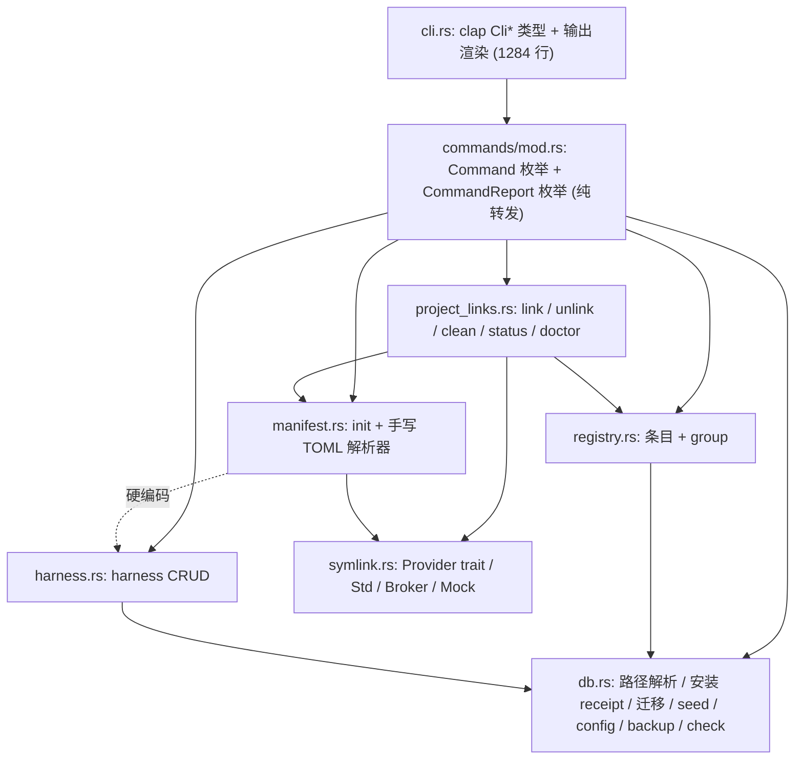

# aglink 代码整体审查（只读，未改动任何代码）

审查范围：`src/` 全部 Rust 源码（以当前工作区为准，含未提交改动）+ `dev-docs/architecture.md`、`03`、`04` 模块文档。

---

## 0. "Group List 为什么会写数据库" —— 根因

**已提交的 HEAD** 中，几乎所有 registry/harness 函数（包括 `list_groups`）都调用 `RegistryStore::open` → [`open_migrated_connection`](file:///f:/00_Workspace/AI_Agents/agent_linker/src/core/db.rs#L402-L410)，它每次都会：

1. `create_dir_all` 数据目录 + `Connection::open`（库不存在就**新建文件**）；
2. 执行 `migrate_connection`；
3. 执行 [`seed_builtin_harnesses`](file:///f:/00_Workspace/AI_Agents/agent_linker/src/core/db.rs#L563-L604)，用 `INSERT … ON CONFLICT DO UPDATE SET updated_at = now` 做 UPSERT，**每次调用都会真实写库**（`frameworks`/`framework_mappings` 的 `updated_at` 每次都会变）。

也就是说"打开连接"这个动作里混进了"建库 + 迁移 + seed"，所以任何命令（包括只读的）都会写库。

**当前工作区（未提交）** 已经把 list/show/link/unlink 改成了 `open_readonly_connection`，症状算是修掉了，但根本问题还在：

- 所有**写**命令仍然走 `open_migrated_connection`，每次写操作都会顺带迁移 + 重新 seed + 改写内置 harness 的 `updated_at`。这和文档 04 里"migration 只在初始化或显式 `db migrate` 时运行"相矛盾。
- 结果是行为不一致：库不存在时，`group list` 报错要求先跑 `db migrate`，而 `group create` 会直接把库建出来。
- seed 是 harness 领域的数据，却写死在 `db.rs` 里，和 [`default_init_mappings`](file:///f:/00_Workspace/AI_Agents/agent_linker/src/core/harness.rs#L60-L87) 维护了同一份数据的**两份拷贝**。

---

## 1. 当前架构速览

关键事实：**`init` 从不读数据库**。它直接用 `harness::default_init_mappings()` 里的硬编码数据（[manifest.rs L162-L184](file:///f:/00_Workspace/AI_Agents/agent_linker/src/core/manifest.rs#L162-L184)）。

---

## 2. 数据库设计问题

| # | 问题 | 位置 | 说明 |
|---|---|---|---|
| D1 | **"打开连接"里做了迁移和 seed** | [db.rs L402-L410](file:///f:/00_Workspace/AI_Agents/agent_linker/src/core/db.rs#L402-L410) | 见第 0 节。应拆成 `open_readonly` / `open_writable`（两者都只校验 schema 版本）和 `migrate`（只由 `db migrate` 或安装器调用）。 |
| D2 | **主键是把名字拼进去的 TEXT** | [registry.rs L739-L745](file:///f:/00_Workspace/AI_Agents/agent_linker/src/core/registry.rs#L739-L745)、[harness.rs L261](file:///f:/00_Workspace/AI_Agents/agent_linker/src/core/harness.rs#L261) | `skill:writer:1730000000000000000` 这种格式，`rename` 后 id 里仍是旧名字，容易误导。manifest 的记录 id 又把它拼了一次（`link:{item.id}:{path}`）。建议改成 `INTEGER PRIMARY KEY` 或 UUID。 |
| D3 | **时间戳存成 `"unix:123"` 字符串** | [util.rs](file:///f:/00_Workspace/AI_Agents/agent_linker/src/core/util.rs) | 不是标准格式，不能按数值排序或比较。应改用 `INTEGER`（epoch）或 ISO-8601。 |
| D4 | **死列 / 重复列** | [db.rs L505-L518、L542-L557](file:///f:/00_Workspace/AI_Agents/agent_linker/src/core/db.rs#L505-L557) | `version`、`commit_hash`（v1）和 `repo_url`、`repo_commit`（v2）从来不写入，而且 `commit_hash` 和 `repo_commit` 语义重复。`source_type`、`source_ownership` 各只有一个取值。`linkable_items.description`、`groups.description` 在 CLI 里没法设置（永远是 `None`）。 |
| D5 | **`frameworks.enabled_by_default`、`built_in` 没有被任何逻辑使用** | [harness.rs](file:///f:/00_Workspace/AI_Agents/agent_linker/src/core/harness.rs) | 只在 `harness show --verbose` 里显示。`enabled_by_default` 和 `enabled` 语义重叠。 |
| D6 | **为了"兼容"保留旧表名 `frameworks*`** | [db.rs L1-L2](file:///f:/00_Workspace/AI_Agents/agent_linker/src/core/db.rs#L1-L2)、manifest 的 `framework_name` | 项目还是 v0.1.0、没有发布过数据，背这个兼容包袱不划算。现在正好可以把 schema 重置成 v1。 |
| D7 | **数据库能保证的唯一性，在 Rust 里又先查一遍** | `ensure_name_available`、`ensure_group_name_available`、`add_mapping` 里的 existing 查询 | `linkable_items(kind,name)` 和 `groups.name` 已经有 UNIQUE 约束，这里属于重复防御。反过来，真正需要约束的地方又没有约束：`framework_mappings(framework_id, link_path)` 没有 UNIQUE；`alias` 没有任何约束。 |
| D8 | **link_name 唯一性靠全表扫描** | [registry.rs L672-L690](file:///f:/00_Workspace/AI_Agents/agent_linker/src/core/registry.rs#L672-L690) | 每次 add/rename 都会把同类型条目全部加载进内存再比较。原因是 resource 的 link_name 是从 `source_path` 的文件名算出来的，没有落库。建议把 `link_name` 存成列，再加 `UNIQUE(kind, link_name)`。 |
| D9 | **name 和 alias 交叉冲突时查找结果不确定** | [registry.rs L313-L332](file:///f:/00_Workspace/AI_Agents/agent_linker/src/core/registry.rs#L313-L332) | `WHERE id=? OR name=? OR alias=?` 配 `query_row` 会静默取第一行。A 的 alias 等于 B 的 name 时，`show`/`rename`/`remove` 可能命中错的条目；而 `find_any_item` 遇到同样情况会报"歧义"，两边行为不一致。 |
| D10 | **多条写语句没有包在事务里** | `add_group_items`、`remove_group_items`、`rename_item` 等 | 先查后写，循环 insert，中途失败会留下部分写入。 |
| D11 | **外键依赖隐式编译参数** | 全部连接 | 代码里从没执行过 `PRAGMA foreign_keys = ON`。`ON DELETE CASCADE` 之所以能生效，只是因为 `libsqlite3-sys` 的 bundled 构建带了 `-DSQLITE_DEFAULT_FOREIGN_KEYS=1`（已在本机 0.30.1 源码中核实）。一旦改用系统 SQLite，group_items 就会出现孤儿行。应在打开连接时显式设置。 |
| D12 | **`config` 表是一个没人读的 KV 存储** | [db.rs L269-L341](file:///f:/00_Workspace/AI_Agents/agent_linker/src/core/db.rs#L269-L341) | 除了 `config get/list` 命令本身，没有任何代码读取配置。 |
| D13 | **`db check` 和 `doctor` 把"有 seed 数据"当成健康标准** | [db.rs L122-L130](file:///f:/00_Workspace/AI_Agents/agent_linker/src/core/db.rs#L122-L130)、[project_links.rs L668-L698](file:///f:/00_Workspace/AI_Agents/agent_linker/src/core/project_links.rs#L668-L698) | 要求 `harness_count>0 && mapping_count>0`，把健康检查和一个实际没被使用的子系统绑在了一起。 |

---

## 3. 过度设计（做了但没用，或者为"未来"预留过多）

1. **整个 Harness 数据库子系统实际上没有效果**：包括 `frameworks`、`framework_mappings` 两张表，以及 `harness list/show/enable/disable/mapping list/add/remove` 七个命令。`init` 不读启用标记，也不读自定义 mapping。[`enabled_harness_mappings`](file:///f:/00_Workspace/AI_Agents/agent_linker/src/core/harness.rs#L208-L229) 只在测试里被调用。用户执行 `harness disable claude` 之后，`init` 照样会创建 `CLAUDE.md`。二选一：要么让 `init` 真正读数据库，要么暂时删掉这个子系统，只保留硬编码映射。
2. **`config` KV 存储没有消费者**（D12）。
3. **为来源管理预留的字段**：`SourceType`、`SourceOwnership` 两个单值枚举加 4 个 repo/version 列（[linkable.rs L35-L59](file:///f:/00_Workspace/AI_Agents/agent_linker/src/core/linkable.rs#L35-L59)），每次都要解析和展示，但永远是同一个值。
4. **`SymlinkBackend` 有生产代码从不使用的变体**：`ExternalLn` 从没构造过；`WindowsStdFallback` 只在测试里出现（[symlink.rs L56-L75](file:///f:/00_Workspace/AI_Agents/agent_linker/src/core/symlink.rs#L56-L75)、L371-L376）。
5. **`SymlinkProvider::read_link`** 只在测试里调用；`LinkStatus::is_existing_real_path` 没有调用方。
6. **`MockSymlinkProvider`/`MockEntry` 编译进了生产二进制**（约 200 行），应改成 `#[cfg(test)]`。
7. **`Error::NotImplemented` 没用到**；[`paths.rs`](file:///f:/00_Workspace/AI_Agents/agent_linker/src/core/paths.rs) 只有一行注释，是空模块。
8. **manifest 记录字段冗余**（[manifest.rs L26-L41](file:///f:/00_Workspace/AI_Agents/agent_linker/src/core/manifest.rs#L26-L41)）：`scope` 永远是 `"project"`；`created_by_command` 和 `provider_backend` 没有任何逻辑读取；条目链接把 `harness_name` 硬塞成 `"registry"`（[project_links.rs L1131](file:///f:/00_Workspace/AI_Agents/agent_linker/src/core/project_links.rs#L1131)），属于字段语义被借用。
9. **手写 TOML 序列化和解析器**（约 250 行，[manifest.rs L428-L665](file:///f:/00_Workspace/AI_Agents/agent_linker/src/core/manifest.rs#L428-L665)）：项目已经依赖了 `serde`，换成 `toml` crate 加 derive 可以删掉大部分代码。现在的实现不支持行尾注释、非字符串值，用户手动编辑后容易解析失败。
10. **Windows 安装 receipt 校验写在数据库路径解析里**（[db.rs L144-L179](file:///f:/00_Workspace/AI_Agents/agent_linker/src/core/db.rs#L144-L179)）：逐个校验 5 个 JSON 字段，receipt 损坏时**所有命令都失败**。安装器的契约侵入了核心路径。更简单的做法：安装器设置 `AGLINK_DATA_DIR`，或者只判断 `<root>/data` 目录是否存在。
11. **CLI surface 有重复入口**：`group link` 和 `link --group`、`group unlink` 和 `unlink --group` 各做同一件事。

---

## 4. 过度防御

| # | 位置 | 说明 |
|---|---|---|
| P1 | [cli.rs L474-L528](file:///f:/00_Workspace/AI_Agents/agent_linker/src/cli.rs#L474-L528) | clap 已经声明了 `conflicts_with`，手写逻辑又判断一遍，`(Some, Some)` 分支实际不可达。 |
| P2 | `add_group_items` / `remove_group_items` | clap 已经设置 `required = true`，函数内又检查 `is_empty()`。另外，重复项或"已经在组里"会直接报错，而不是幂等处理，对 CLI 用户不友好。 |
| P3 | `Manifest::validate` | 在 parse、save 里各调一次，init 又额外调一次，同一份数据最多校验 3 次。 |
| P4 | [db.rs L315-L331](file:///f:/00_Workspace/AI_Agents/agent_linker/src/core/db.rs#L315-L331) | `set_config` 写完后又开一个新连接读回来，还要处理"写了但没存进去"这种不可能发生的错误。 |
| P5 | [db.rs L348-L395](file:///f:/00_Workspace/AI_Agents/agent_linker/src/core/db.rs#L348-L395) | backup 先检查目标是否存在，再用 `create_new` 占位，再执行 `VACUUM INTO`。`VACUUM INTO` 本身就会拒绝覆盖非空文件，前面两层可以去掉。 |
| P6 | [db.rs L237-L245](file:///f:/00_Workspace/AI_Agents/agent_linker/src/core/db.rs#L237-L245) | 可写性探测用 `BEGIN IMMEDIATE; PRAGMA user_version=v; ROLLBACK`，又另开一个只读连接读同样的信息。 |
| P7 | [commands/mod.rs L491-L511](file:///f:/00_Workspace/AI_Agents/agent_linker/src/commands/mod.rs#L491-L511) | 用 `include_str!("mod.rs")` 搜自己的源码来检查分层规则，为了避开自检还要写 `concat!("rusq","lite")`。分层应该靠模块可见性（`pub(crate)`）来保证。 |
| P8 | [symlink.rs L413-L500](file:///f:/00_Workspace/AI_Agents/agent_linker/src/core/symlink.rs#L413-L500) | `WindowsBrokerSymlinkProvider` 给非 Windows 平台写了 4 个"不支持"桩。整个类型直接 `#[cfg(windows)]` 即可。 |
| P9 | `CreateSymlinkOptions` | 只包一个 `bool`，却有 `new()`、`force_wrong_symlink()`、`Default` 三种构造方式，`project_links` 里还多了一个 `create_symlink_options(force)` 转换函数。 |
| P10 | 文件系统 Provider 的 `create_symlink` | `ensure_symlink` 已经做过 `link_status` 判定，`create_symlink` 里又重复做 source、parent、link 是否存在三项检查。这里涉及真实文件安全，可以保留，但应该集中在一个地方。 |
| P11 | `validate_project_root` | 每个操作开头都检查 `current_dir()` 是不是目录，cwd 不可能不是目录。 |

---

## 5. 结构问题（需要重构）

### 5.1 三层几乎一一对应的命令类型
`CliCommand`（clap）→ `commands::Command` → core 函数，再加一个 `CommandReport` 枚举。[commands/mod.rs](file:///f:/00_Workspace/AI_Agents/agent_linker/src/commands/mod.rs) 512 行基本是纯转发；`CliSkillCommand` 和 `CliResourceCommand` 几乎一样。**建议**：让 clap 类型直接作为命令枚举，`commands` 层只负责"打开 store + 调用 core + 返回 report"。

### 5.2 project_links 公共 API 变体太多
每个操作都有 4 到 6 个入口，例如 `link_current_project`、`link_current_project_with_options`、`link_project_with_provider`、`link_project_with_provider_and_db`、`link_project_with_provider_and_db_with_options`、`link_project_with_provider_and_store`（[L146-L354](file:///f:/00_Workspace/AI_Agents/agent_linker/src/core/project_links.rs#L146-L354)），主要是为了方便测试。**建议**：引入 `ProjectCtx { root, provider, store }`，每个操作只保留一个 `fn op(ctx, args, opts)`。

### 5.3 连接管理
每个 core 函数都接收 `&DbPathResolution` 然后**自己开连接**；`RegistryStore` 只是给 `*_with_connection` 自由函数包了一层，所以实际有"自由函数 → Store 方法 → `_with_connection` 函数"三层。**建议**：一个 `Store` 类型（持有 `Connection`），区分 `open_ro` 和 `open_rw`，registry/harness/config 都作为它的方法，每个命令只开一次连接。

### 5.4 db.rs 职责过多（约 770 行非测试代码）
路径解析、安装 receipt、schema 迁移、harness seed、config CRUD、backup、check 都在这一个文件里。**建议**拆成 `store/path.rs`、`store/schema.rs`、`store/config.rs`，seed 移到 harness 模块。

### 5.5 project_links.rs 职责过多（约 1200 行非测试代码）
link、unlink、clean、status 和 doctor（含 Windows Broker 探测）都放在一起。doctor 应该独立出来。

### 5.6 重复代码
- "LinkStatus → SymlinkError" 的映射写了 **4 遍**：[`ensure_symlink`](file:///f:/00_Workspace/AI_Agents/agent_linker/src/core/symlink.rs#L286-L344)、[`plan_symlink`](file:///f:/00_Workspace/AI_Agents/agent_linker/src/core/project_links.rs#L987-L1044)、[`preflight_unlink`](file:///f:/00_Workspace/AI_Agents/agent_linker/src/core/project_links.rs#L847-L894)、[`planned_remove_outcome`](file:///f:/00_Workspace/AI_Agents/agent_linker/src/core/project_links.rs#L896-L931)。dry-run 应该由 Symlink Core 提供（`plan` 和 `apply` 共用同一套判定）。
- `unlink_selected_indexes` 和 `clean` 里的删除循环几乎相同。
- `validate_project_root` 在 manifest.rs 和 project_links.rs 各有一份；`path_to_registry_text` 和 `path_to_db_text` 重复；`parse_link_kind` 在 linkable.rs 和 manifest.rs 各有一份；"项目内相对路径"的校验写了 3 处（`validate_mapping_path`、`validate_project_relative_target_dir`、`prepare_link_parent`）。
- `link_name_for_request` 重复了 `LinkableItem::link_name`；`project_link_path_for_item` 重复了 `default_project_link_path`（后者只在 CLI 展示和测试里用）。
- item 的 SELECT 列清单抄了 5 次；harness 的行映射在 list 和 show 里各写一次；`list_harness_mappings` 为了绑定参数写了两套分支。
- 相同概念有两套类型：`HarnessDefinition`/`HarnessMapping`（带 `item_id`/`item_name`）和 `StoredHarness`/`StoredHarnessMapping`。

### 5.7 错误模型
- "unknown group/skill/harness" 这类找不到的错误被归为 `Error::Database`，应该单独有一个 `NotFound`。
- `Error::Io(String)` 把 `io::Error` 压成字符串，丢失了错误类型和路径。
- `print_error(&error, _options)` 有一个没用的参数。

---

## 6. 审查中顺带发现的行为问题（不属于设计偏好）

1. **`unlink --all` 会连 init 创建的 `CLAUDE.md` 和 `.claude/skills` 一起删掉**，因为它们也在 manifest 里，`select_unlink_indexes(None)` 会选中全部记录。`clean` 的默认模式也会丢弃这些记录。
2. **skill rename 之后已有的项目链接会变成孤儿**：manifest 里还是旧路径，再次 `link` 会在新路径另建一个，旧链接只能手动 unlink。
3. **group link 不是原子操作**：每个 item 都独立加载和保存一次 manifest，中途失败会留下部分链接。另外 `prepare_link_parent` 在检查 manifest 冲突**之前**就建好了父目录，冲突报错后目录会残留。
4. `.gitignore` 托管块忽略了整个 `.agents/skills/`，而文档把 `.agents/` 定义为"真实源"。用户自己放进 `.agents/skills/` 的真实 skill 也会被忽略，需要确认这是不是预期行为。

---

## 7. 建议的处理顺序（供决策，暂不执行）

| 优先级 | 事项 |
|---|---|
| P0 | D1：去掉"打开即迁移/seed"，读写都只做版本校验，迁移只在 `db migrate` 或安装时执行；同时显式打开 `foreign_keys`（D11），多语句写操作加事务（D10）。 |
| P0 | 决定 Harness 子系统的去留（第 3 节第 1 条）：接入 `init`，或者删掉。 |
| P1 | 趁现在还没有发布数据，重置 schema：整数主键、整数时间戳、删除死列和兼容表名、`link_name` 落库并加 UNIQUE（D2–D9）。 |
| P1 | 引入 `Store` 和 `ProjectCtx`，合并 project_links 的 API 变体，删掉 `commands` 的转发层（5.1–5.3）。 |
| P2 | 把 dry-run 和状态到错误的映射收进 Symlink Core（5.6）；manifest 改用 `toml` crate 并精简字段（第 3 节第 8、9 条）。 |
| P2 | 清理死代码：Mock 改为 cfg(test)，删除没用的 backend 变体、`paths.rs`、`NotImplemented`、`config` 等（第 3 节）。 |
| P2 | 处理第 6 节的行为问题。 |
