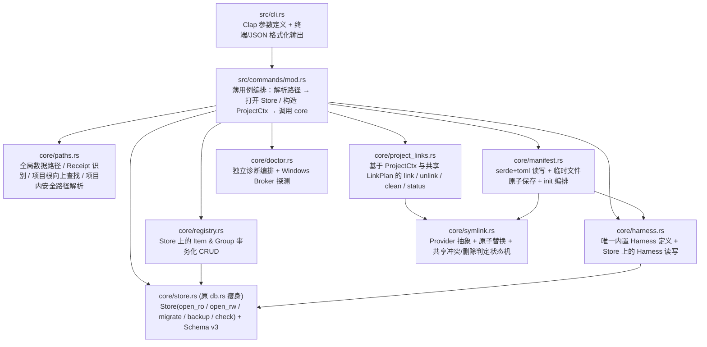

# Agent Linker (`aglink`) 代码审查与重构最终裁决方案

> **状态**：已拍板定稿（产品与技术裁决全部确认，尚未修改业务代码）  
> **裁决输入**：综合三方独立代码审查（初轮架构审查、[重构-gpt.md](重构-gpt.md)、[重构-claude.md](重构-claude.md)）及当前仓库事实源（[architecture.md](architecture.md)、[handoff-windows-install-data-layout.md](handoff-windows-install-data-layout.md)、`dev-docs/modules/01~07` 与工作区源码）。

---

## 一、 裁决总则（四大基准）

三份审查在“连接生命周期耦合、事务缺失、重复包装与死代码”上高度一致，但在**数据库 Schema 是否推倒重置、缺库查询行为、Windows 安装收据校验、Resource 唯一性边界**等关键点存在明显分歧。本次最终裁决以以下四条工程准则为准绳：

1. **真实文件与项目边界安全绝对优先**：任何场景下绝不越界删除项目外路径、绝不因命名冲突删错注册项、绝不覆盖或误删用户真实文件/目录。
2. **尊重本机在役生产数据，禁止暴力清库重置**：根据 [handoff-windows-install-data-layout.md](handoff-windows-install-data-layout.md)，本机 `C:\Program Files\aglink\data\agent-linker.db` 已有正式在役数据（含已注册技能与分组），且已有项目存在 `.agents/links.toml`。Schema 净化必须通过 **SQLite 事务性迁移（Migration v3 表重建）** 平滑完成，不得直接推翻重置导致存量库或存量 Manifest 失效。
3. **连接打开与迁移/初始化严格解耦**：日常读连接（`open_ro`）与写连接（`open_rw`）均**不得**隐式创建数据库、执行 DDL 迁移或写入默认 Seed；初始化与迁移只允许由显式 `aglink db migrate`（及安装/打包脚本）触发。
4. **砍掉无消费者的伪扩展，闭合核心链路**：不保留“能存但业务完全不读”的半成品功能——属于核心定位的（Harness）补齐最小闭环，毫无消费者的（`config`、预留死列）直接下线。

---

## 二、 核心问题定案：`group list` 为什么会写数据库？

结合 Git 提交历史与当前工作区未提交改动，问题全貌如下：

1. **已提交版本（`HEAD`）与旧安装二进制的直接根因**：  
   `list_groups` 等只读查询调用了 `RegistryStore::open` → [`open_migrated_connection`](../src/core/db.rs)。该函数在**每一次打开连接时**都会无条件执行：
   - 创建数据目录并打开可写连接（缺库即建文件）；
   - 运行 `migrate_connection`；
   - 运行 [`seed_builtin_harnesses`](../src/core/db.rs)，执行 3 条 `INSERT ... ON CONFLICT DO UPDATE SET updated_at = ?1`，**每次查询都真实改写数据库行**。在沙箱或只读权限下查询会直接报错失败。
2. **当前工作区（未提交改动）遗留的半成品矛盾**：  
   工作区已将 `list/show/link` 等读入口切到 `open_readonly_connection`，消除了“已初始化库上的查询写库”，但留下了两处结构性扭曲：
   - **普通写命令仍在隐式建库/迁移/Seed**：`skill add`、`group create` 等仍走 `open_migrated_connection`。哪怕执行 `aglink skill add ./不存在的路径` 因参数校验失败，数据库文件和默认 Harness 数据也已经被偷偷写入磁盘；且正常写操作每次都会无意义刷新内置 Harness 的 `updated_at`。
   - **读写行为不对称**：在未初始化环境（如本地 `cargo run` 默认回退到 `%LOCALAPPDATA%`）下，`group list` 报错要求先跑 `aglink db migrate`（写库），而 `group create` 却静默自动建库，造成体验割裂。

**【最终裁决】**：彻底废弃 `open_migrated_connection`。全局存储统一拆分为三个职责单一的入口：
- `Store::open_ro`：`SQLITE_OPEN_READ_ONLY` + `PRAGMA query_only = ON`，校验 `schema_version == LATEST`。
- `Store::open_rw`：`SQLITE_OPEN_READ_WRITE`（**不带** `SQLITE_OPEN_CREATE`）+ `PRAGMA foreign_keys = ON`，校验 `schema_version == LATEST`。
- `Store::migrate`：唯一允许 `create_dir_all` + `SQLITE_OPEN_CREATE` + 执行迁移与初始化 Seed 的入口，仅由 `aglink db migrate` 调用（正常安装、Portable 打包由脚本自动执行该命令；源码调试首跑显式执行一次）。缺库时读写行为完全一致且无隐式副作用。

---

## 三、 七大争议点最终裁决表

针对 GPT、Claude 与初审意见不一致之处，逐项裁决如下：

| # | 争议议题 | 各方观点分歧 | 最终裁决与工程理由 |
|---|---|---|---|
| **1** | **SQLite Schema 重整方式** | **Claude / 初审**：趁 v0.1.0 直接把 Schema 重置为 v1，改用 `INTEGER` 主键并删旧名。<br>**GPT**：已有库兼容要求下不能直接删改破坏旧数据。 | **采用 Migration v3 事务性表重建（Table Rebuild）**。<br>利用 SQLite `CREATE TABLE new -> INSERT SELECT -> DROP -> RENAME` 在 `v2 -> v3` 中一次性将 `frameworks*` 正名为 `harnesses*`、清理死列、将时间戳转为 `INTEGER`。**主键保留 `TEXT PRIMARY KEY`**：存量 ID 原样保留（确保已有项目 `.agents/links.toml` 中的 `item_id` 不断链），新记录改为生成无业务语义的固定格式随机 ID（如 `itm_<16hex>` / `grp_<16hex>`），彻底解决 `rename` 后 ID 残留旧名的问题。 |
| **2** | **Harness 动态子系统去留** | **初审 / Claude**：7 个命令和 2 张表未被 `init` 使用，建议要么删掉要么接入 `init`。<br>**GPT**：消除代码硬编码与 DB Seed 两份数据源，收敛未闭环能力。 | **保留并接入 `init` 完成最小闭环，统一单一数据源**。<br>多 Harness 兼容映射是产品核心价值。修改 `aglink init`：当全局库已初始化时，只读查询已启用的 Harness 及其 mappings 创建兼容软链（全局库未初始化时回退内置 `claude` 默认映射，保证纯本地 `init` 可用）。删除 `db.rs` 中重复硬编码的 Seed SQL，改为在 `migrate` 时遍历 `harness::builtin_harnesses()` 执行 `INSERT OR IGNORE`（不再覆盖用户状态与 `updated_at`）。 |
| **3** | **`config` 表与命令去留** | **GPT**：先定义有效配置键和类型再决定接口。<br>**Claude**：完全无消费者的 KV 存储，建议删除。 | **MVP 直接移除 `config` 表与 `aglink config` 命令**。<br>目前全工程没有任何业务代码消费 `config`，而 `config path` 与 `db path` 完全重复。保留“能写任意键却毫无作用”的命令只会误导用户；待未来出现真实全局偏好需求时再按强类型配置引入。 |
| **4** | **Resource 唯一性与 `--alias` 语义** | **Claude**：建议将 `link_name` 落库并加 `UNIQUE(kind, link_name)`。<br>**GPT**：同类型全局限制同名文件属于过度防御（拦截了不同目录下的同名 `config.json`）；且 `name`/`alias` 共用查找空间导致删错项。 | **采纳 GPT，修正命名空间与唯一性粒度**：<br>1. **查找空间隔离**：`linkable_items.name` 设为**跨类型全局唯一**（`UNIQUE(name COLLATE NOCASE)`，消除 `aglink link <name>` 跨类型歧义）；`alias` 明确回归**默认链接文件名覆盖**职责，不再参与 `show/rename/remove/refresh/link` 的模糊匹配，彻底根绝 `alpha --alias beta` 导致 `remove beta` 误删 `alpha` 的漏洞。<br>2. **目标路径唯一性**：落库 `default_link_name`，Skill 在 `.agents/skills/<link_name>` 上唯一；Resource 按归一化后的 `(target_dir, default_link_name)` 判重，允许 `tool-a/config.json` 与 `tool-b/config.json` 合法共存。 |
| **5** | **Windows 安装 `install-receipt.json` 校验** | **Claude / 初审**：认为路径解析里校验 5 个 JSON 字段过度防御，建议改用环境变量或仅判 `data/` 目录。<br>**GPT / Handoff**：需防 `.cargo/bin` 误判且不能依赖沙箱内易失效的环境变量。 | **保留 Receipt 识别与损坏显式报错机制，迁入 `paths.rs` 并收敛字段**。<br>不改用环境变量或裸 `data/` 目录判断（保障终端与 Agent 沙箱定位同一物理库，且不误伤 `~/.cargo/bin`）。但将解析逻辑从 `db.rs` 剥离至 `core/paths.rs`，仅校验核心身份字段（`schema_version == 1`、`product == "agent-linker"`、`portable == false`），移除对安装脚本文件名 `"installed_by": "aglink-installer.ps1"` 的脆弱耦合。 |
| **6** | **项目根目录定位策略** | **初审**：建议支持在子目录（如 `src/`）向上递归查找项目根。<br>**模块文档 `02`**：规定 `aglink init` 只作用于当前目录。 | **按命令性质区分对待**：<br>- `aglink init`：**严格只作用于 `current_dir()`**，防止在子模块目录误修改上层仓库。<br>- `link / unlink / status / clean / doctor`：从 `current_dir()` 向上查找包含 `.agents/links.toml` 的目录（遇到文件系统根或符号链接目录即停止），同时删除无意义的 `cwd.is_dir()` 防御检查。 |
| **7** | **备份 `VACUUM INTO` 前置占位** | **初审 / Claude**：认为前置检查与 `create_new` 占位多余。 | **保留原子防覆盖语义，去除冗余的二次元数据检查**。<br>SQLite `VACUUM INTO` 会拒绝非空文件，但**允许覆盖已存在的 0 字节空文件**。因此去掉前置冗余的 `path_metadata` 检查（消除 TOCTOU 重复），或仅在目标不存在时直接交由 SQLite 执行（对 0 字节预存在文件用一次 `symlink_metadata` 拦截即可，无需先建空文件再删）。 |

---

## 四、 P0 级安全与正确性缺陷清单（最高优先级止血）

以下问题直接威胁文件安全、数据正确性或状态一致性，必须在结构美化之前先行修复：

### P0-1：Manifest 路径越界与祖先符号链接逃逸（高危安全边界）
- **现状定位**：[`Manifest::validate`](../src/core/manifest.rs) 校验了大量字符串非空，却允许 `link_path` 为绝对路径、包含 `..` 或多条记录指向同一 `link_path`；[`unlink_selected_indexes`](../src/core/project_links.rs) 与 `clean` 直接执行 `project_root.join(&record.link_path)` 删除目标，未校验父目录链是否被替换为指向项目外的 symlink；`load_manifest`/`save_manifest` 也未检查 `.agents` 目录本身是否为真实目录。
- **整改动作**：
  1. 在 `core/paths.rs` 实现统一的 `resolve_managed_project_path(project_root, rel_path)`：拒绝空路径、绝对路径、盘符前缀及任何 `..` 组件；逐级通过 `fs::symlink_metadata` 验证父目录绝非 symlink。
  2. 创建、读取、状态检查、取消链接、清理以及读写 `.agents/links.toml` **全部复用该安全解析入口**。
  3. `Manifest::validate` 增加 `link_path` 相对路径合法性与唯一性校验（Windows 下按大小写无关判重）。

### P0-2：标识符与 Alias 混用查询空间导致删错注册项
- **现状定位**：[`find_item_with_connection`](../src/core/registry.rs) 使用 `WHERE kind = ?1 AND (id = ?2 OR name = ?2 OR alias = ?2) ORDER BY name` 并直接取第一行。当存在 `alpha --alias beta` 与 `beta` 时，`aglink skill remove beta` 会静默选中并删除 `alpha`。
- **整改动作**：按“裁决 4”执行——`name` 全局唯一，命令标识符解析仅匹配 `name`（及精确主键 `id`），`alias` 仅作为默认落盘链接名，不再混入查询命名空间。

### P0-3：`unlink --all` 误拆 `init` 创建的 Harness 兼容层 & `group unlink` 语义不清
- **现状定位**：`init` 生成的 `CLAUDE.md`、`.claude/skills` 与普通 `link` 条目混存于 `manifest.links`（甚至将普通条目的 `framework_name` 硬塞为 `"registry"`）。执行 `aglink unlink --all` 时，[`select_unlink_indexes(None)`](../src/core/project_links.rs) 会选中全部记录，把项目的 Harness 兼容结构一并删掉。
- **整改动作**：
  1. 为 Manifest 条目引入明确的来源类型区分（如 `origin = "harness" | "item"`，`harness` 仅在 `origin == "harness"` 时有值；兼容读取旧版 `framework_name = "registry"` 自动映射为 `origin = "item"`）。
  2. `aglink unlink --all` 严格限定只解绑 `origin == "item"` 的注册表链接，绝不触碰 `origin == "harness"` 的项目基础设施链接。
  3. 明确固定 `group unlink <group>` 语义为“解绑当前项目中 `item_id` 属于该分组当前成员的所有 `item` 链接”，并在文档写明。

### P0-4：`--force` 非原子替换导致失败丢链，以及断链无法强制替换
- **现状定位**：
  1. [`ensure_symlink`](../src/core/symlink.rs) 在 `--force` 下先调用 `remove_symlink` 删除旧链接，再调用 `create_symlink`。一旦第二步失败（如 Windows Broker 未运行），原链接永久丢失。
  2. 当目标位置是一个旧的 `BrokenSymlink` 时，即使传入 `--force` 且新 `source` 完全有效，`ensure_symlink` 也会报 `SourceNotFound` 拒绝替换。
- **整改动作**：
  1. 将“原子替换已有 symlink”下沉到 `SymlinkProvider` 接口（或 `replace_symlink` 方法）：Windows Broker 后端直接启用 `win-symlinks-client` 原生支持的 `replace_existing_symlink = true`；Unix `Std` 后端在同目录创建临时 symlink 后执行 `fs::rename` 原子覆盖。真实文件/目录仍严格拒绝替换。
  2. 修正冲突状态机：当新 `source` 校验存在且目标位置为 `WrongSymlinkTarget` **或** `BrokenSymlink`（目标不一致或已断链）时，`--force` 均允许安全替换该 symlink。

### P0-5：SQLite 事务/外键缺失、分组操作非原子与 Manifest 覆盖截断风险
- **现状定位**：
  1. 所有 SQLite 连接从未显式执行 `PRAGMA foreign_keys = ON`（目前仅靠 `rusqlite` bundled 编译参数巧合生效）。
  2. `add_group_items`、`remove_group_items`、`rename_item` 等无事务保护，循环写入中途失败会留下半成品数据。
  3. `group link` 逐项立即创建父目录、建链并反复读写 manifest；dry-run 不维护组内虚拟状态（漏报组内两成员指向同一路径的冲突），实际执行中途失败会残留已建父目录和部分软链。
  4. `save_manifest` 直接 `fs::write` 覆盖原文件，进程异常中断会导致 `.agents/links.toml` 截断损坏。
- **整改动作**：
  1. `Store::open_rw` 统一执行 `PRAGMA foreign_keys = ON`；所有写命令以单次命令为边界包裹在 `Transaction` 中。
  2. `link` / `group link` / `unlink` / `clean` 全面改为 **Plan → Validate → Execute**：先在内存中算出全部目标路径变更集，检查组内互冲与磁盘状态（`--dry-run` 在此直接返回 Plan，不再维护第二套状态机！）；全部通过后再创建缺失父目录、执行 symlink 变更，最后**一次性原子保存** Manifest（写入 `.agents/.links.toml.tmp.<pid>` 后 `fs::rename` 替换目标）。

---

## 五、 数据库设计专项整改规范（Schema v3）

SQLite 作为全局注册表与分组关系的存储选型完全合理，无需更换存储引擎，但需通过 **Migration v3** 一次性修正表结构与查询反模式：

### 1. 目标表结构（Schema v3）
```sql
-- 1. Harness 定义表（由 frameworks 正名，删除无用的 enabled_by_default）
CREATE TABLE harnesses (
    id TEXT PRIMARY KEY NOT NULL,
    name TEXT NOT NULL UNIQUE COLLATE NOCASE,
    display_name TEXT NOT NULL,
    built_in INTEGER NOT NULL CHECK (built_in IN (0, 1)),
    enabled INTEGER NOT NULL CHECK (enabled IN (0, 1)),
    created_at INTEGER NOT NULL,
    updated_at INTEGER NOT NULL
);

-- 2. Harness 映射表（补齐 (harness_id, link_path) 唯一约束）
CREATE TABLE harness_mappings (
    id TEXT PRIMARY KEY NOT NULL,
    harness_id TEXT NOT NULL REFERENCES harnesses(id) ON DELETE CASCADE,
    source_path TEXT NOT NULL,
    link_path TEXT NOT NULL COLLATE NOCASE,
    link_kind TEXT NOT NULL CHECK (link_kind IN ('file', 'directory')),
    required INTEGER NOT NULL CHECK (required IN (0, 1)),
    created_at INTEGER NOT NULL,
    updated_at INTEGER NOT NULL,
    UNIQUE (harness_id, link_path)
);

-- 3. 可链接条目注册表（清理 6 个预留死列，落库 default_link_name，name 全局唯一）
CREATE TABLE linkable_items (
    id TEXT PRIMARY KEY NOT NULL,
    kind TEXT NOT NULL CHECK (kind IN ('skill', 'resource')),
    name TEXT NOT NULL UNIQUE COLLATE NOCASE,
    alias TEXT,
    default_link_name TEXT NOT NULL,
    source_path TEXT NOT NULL,
    source_kind TEXT NOT NULL CHECK (source_kind IN ('file', 'directory')),
    target_dir TEXT,
    description TEXT,
    created_at INTEGER NOT NULL,
    updated_at INTEGER NOT NULL
);

-- Skill 默认目标目录固定为 .agents/skills，因此同为 skill 时 default_link_name 唯一
CREATE UNIQUE INDEX idx_skill_default_link_name
    ON linkable_items(default_link_name COLLATE NOCASE)
    WHERE kind = 'skill';

-- Resource 在相同 target_dir 下 default_link_name 唯一，不同目录允许同名文件
CREATE UNIQUE INDEX idx_resource_target_link_name
    ON linkable_items(target_dir COLLATE NOCASE, default_link_name COLLATE NOCASE)
    WHERE kind = 'resource';

-- 4. 分组与成员关系表
CREATE TABLE groups (
    id TEXT PRIMARY KEY NOT NULL,
    name TEXT NOT NULL UNIQUE COLLATE NOCASE,
    description TEXT,
    created_at INTEGER NOT NULL,
    updated_at INTEGER NOT NULL
);

CREATE TABLE group_items (
    group_id TEXT NOT NULL REFERENCES groups(id) ON DELETE CASCADE,
    item_id TEXT NOT NULL REFERENCES linkable_items(id) ON DELETE CASCADE,
    created_at INTEGER NOT NULL,
    PRIMARY KEY (group_id, item_id)
);
```

### 2. 查询与诊断修正
- **消除 `list_groups` 的 N+1 查询与重型加载**：  
  `aglink group list` 终端仅展示分组名与成员数量。新增轻量级 `list_group_summaries`：使用单条 `SELECT g.id, g.name, COUNT(gi.item_id) FROM groups g LEFT JOIN group_items gi ON gi.group_id = g.id GROUP BY g.id ORDER BY g.name`，不再循环查询并反序列化全部成员的 14 个字段。
- **依靠数据库唯一约束取代“先查后插”全表扫描**：  
  删除 `ensure_link_name_available` 的全表内存遍历以及 `ensure_name_available` / `ensure_group_name_available` 的前置冗余 SELECT，直接捕获 SQLite `CONSTRAINT_UNIQUE` 错误并映射为清晰的用户提示，兼顾简洁与并发正确性。
- **重构 `db check` 与退出码（修复假阳性与 0 退出码漏洞）**：  
  1. 结构完整性校验：检查 `sqlite_master` 中核心表（`harnesses`、`harness_mappings`、`linkable_items`、`groups`、`group_items`）齐全且 `PRAGMA quick_check` 通过，不再把 `harness_count > 0` 当作数据库健康标准（防止删掉 `group_items` 表仍报 `ok`）。
  2. 状态解耦：将连接检查拆分为明确的枚举状态（`Missing` / `SchemaMismatch` / `ReadOnly` / `LockedBusy` / `HealthyWritable`），不再把锁竞争和权限不足笼统压成一个 `writable = false`。
  3. 修复 [`CommandReport::is_success`](../src/commands/mod.rs)：`CommandReport::DbCheck(report)` 不健康时必须返回非 0 退出码，确保安装/运维脚本可据此可靠阻断异常升级。

---

## 六、 过度设计与过度防御清理清单

在重构中应集中删除或收敛的冗余实现：

1. **下线死特性与死字段**：
   - 删除 `config` 表、`aglink config` 子命令族及其全部测试/报表分支。
   - 删除 `SourceType`、`SourceOwnership` 单值枚举及 `version`、`commit_hash`、`repo_url`、`repo_commit` 死列。
   - 删除 `Error::NotImplemented`、`SymlinkBackend::ExternalLn`、`LinkStatus::is_existing_real_path`。
   - 删除 Manifest 中的恒定字段 `scope = "project"`；对历史遗留或未知的 `provider_backend` 审计字符串做宽容解析（如 `Unknown(String)`），绝不因历史记录中的后端名阻碍 `clean` / `unlink`。
2. **用标准库/生态替换自造轮子**：
   - 引入 `toml` crate，配合 `serde::Serialize` / `Deserialize` 替换 [`manifest.rs`](../src/core/manifest.rs) 中约 250 行手写 TOML 行解析与转义器。
   - 使用 `rusqlite` 原生 `bool` 绑定与读取，删除 `bool_to_i64` / `int_to_bool` 胶水代码；时间戳统一用 `i64` Unix 秒（CLI `--verbose` 展示时格式化为可读 UTC 时间）。
3. **剥离编译进生产包的测试与平台桩代码**：
   - [`MockSymlinkProvider`](../src/core/symlink.rs) 及其辅助结构（约 200 行）加 `#[cfg(test)]`。
   - `WindowsBrokerSymlinkProvider` 整体加 `#[cfg(windows)]`，删除非 Windows 平台下的 4 个无意义报错桩方法。
   - 删除 `commands/mod.rs` 末尾通过 `include_str!("mod.rs")` 检索源码字符串的脆弱架构自检测试，改用 Rust `pub(crate)` 可见性在编译期约束分层。
4. **清理过度防御与体验摩擦**：
   - 删除 `cli.rs` 中与 `clap` 属性（`conflicts_with`、`required = true`）完全重复的手工参数互斥校验。
   - `group add` / `group remove` 对同一次输入去重，对“已在组内”采取幂等跳过并提示（而非整批报错中断）。
   - 规范化 Windows `fs::canonicalize` 产生的 `\\?\` 扩展路径前缀（在非超长普通磁盘路径下去掉 `\\?\` 再落库与展示），消除终端输出丑陋及路径比对不一致问题。
   - 简化 `CreateSymlinkOptions`（直接内聚到 `LinkOptions` 或单字段结构，删掉多余构造函数与转换器）。

---

## 七、 目标模块结构与代码瘦身蓝图

保持 `AGENTS.md` 规定的单 crate 与 `cli -> commands -> core` 依赖方向不变，但消除“纯转发类型膨胀”与“5~7 层重载函数套娃”：



### 关键结构收敛措施
1. **引入 `ProjectCtx` 消灭函数套娃**：  
   在 `core/project_links.rs` 定义：
   ```rust
   pub struct ProjectCtx<'a> {
       pub root: &'a Path,
       pub provider: &'a mut dyn SymlinkProvider,
   }
   ```
   将原本每个操作 4~6 个的 `*_current_project` / `*_with_provider` / `*_with_provider_and_db_with_options` 全部坍缩为**唯一核心函数**（如 `pub fn link_item(ctx: &mut ProjectCtx, store: &Store, req: &LinkItemRequest, opts: LinkOptions)`）。生产代码在 `commands` 层组装 `ProjectCtx` 与 `Store`（每个命令只开一次数据库连接），测试代码直接传入 `TestDir` + `MockSymlinkProvider` + 临时 `Store`。
2. **合并 Dry-Run 与真实执行状态机**：  
   删除 `project_links.rs` 中重复编写的 `plan_symlink`、`preflight_unlink`、`planned_remove_outcome`（当前把 `LinkStatus -> SymlinkError` 抄写了 4 遍）。由 `core/symlink.rs` 统一提供无副作用的 `evaluate_create` / `evaluate_remove` 纯判定函数，Plan 阶段与 Execute 阶段共享同一套冲突规则。
3. **精简 `cli` ↔ `commands` 重复定义**：  
   合并 `CliSkillCommand` 与 `CliResourceCommand` 的公共子命令结构；`group link/unlink` 与 `link/unlink --group` 在解析后直接归一为同一个 `Command` 变体，消除双线维护。
4. **结构化错误模型升级（`core/error.rs`）**：  
   拆分 `Error::NotFound`、`Error::Conflict`、`Error::DatabaseBusy`、`Error::PermissionDenied`、`Error::Io { path: Option<PathBuf>, source: io::Error }`，不再把底层错误全部 `.to_string()` 抹平；让全局 `--verbose` 在 `print_error` 中真正输出错误源链、涉及路径与平台/Broker 错误码。

---

## 八、 分阶段实施路线图（Phased Roadmap）

为控制变更半径、确保每一步均可独立测试验收，建议按以下三个阶段推进：

### 阶段一：安全边界与状态一致性止血（P0）
1. 实现 `core/paths.rs`（接管全局路径、Receipt 最小校验、项目根定位、项目内受控路径非 symlink 祖先校验、Windows `\\?\` 规范化）。
2. 为 `Manifest` 补齐路径安全校验、引入 `origin` 字段隔离 Harness 链接与普通条目（修复 `unlink --all` 误删 `CLAUDE.md`），改为同目录临时文件原子写入；同步将 `init` 的 `.gitignore` 托管块收敛为 `.claude/` 与 `.agents/`。
3. 修复 `SymlinkProvider` 原子替换（Broker `replace_existing_symlink` / Unix 临时链 `rename`）及 `--force` 下断链替换逻辑。
4. 修复标识符命名空间（`name` 唯一查找、`alias` 仅作默认链接名），彻底消除误删其他注册项漏洞。

### 阶段二：存储层解耦与 Schema v3 平滑迁移（P1）
1. 实现 `Store::open_ro`、`Store::open_rw`（强制 `PRAGMA foreign_keys = ON`）与 `Store::migrate` 三入口分离；所有多步写操作包裹事务。
2. 编写并验证 **Migration v2 → v3**（表重建正名 `harnesses*`、移除死列与 `config` 表、迁移整型时间戳、保留存量 ID 并切换新 ID 生成器、建立 `idx_skill_default_link_name` 与 `idx_resource_target_link_name`）。
3. 优化 `list_groups` 为单条聚合 SQL；重构 `db check` 表结构校验、锁状态区分与非 0 退出码。
4. 将 `aglink init` 接入全局库已启用 Harness 映射（保留未初始化时的内置 `claude` 回退），统一 `harness.rs` 为唯一内置数据源；下线 `aglink config`。
5. 核对并同步安装/打包脚本（确保源码外所有分发形态均在安装/构建期完成 `db migrate`）。

### 阶段三：架构瘦身、状态机收敛与对抗测试补齐（P2）
1. 引入 `toml` crate 重写 `manifest.rs` 序列化层，宽容处理未知历史后端字段。
2. 引入 `ProjectCtx` 与共享 `LinkPlan`，删除 `project_links.rs` 中全部套娃重载函数与重复冲突判定逻辑，将 `doctor` 拆至独立模块 `core/doctor.rs`。
3. 升级 `core/error.rs` 结构化错误并接通 `--verbose` 诊断输出；隔离 `#[cfg(test)]` Mock 代码与 `#[cfg(windows)]` 平台代码，清理全部死代码。
4. 补齐边界与故障注入测试：项目外路径拦截、父目录被替换为 symlink 拦截、同名/alias 交叉、组内同路径冲突 dry-run 检出、`--force` 建链失败保住原链、批量写中途失败事务回滚、v2 存量库（含本机真实数据形态）升级 v3 无损迁移测试。

---

## 九、 已拍板的产品语义定案

以下两项产品行为边界已最终确认，直接作为实施与验收标准（同时在施工阶段同步更新 `dev-docs/modules/02` 与 `05` 契约说明）：

1. **`.gitignore` 托管块整体忽略 `.claude/` 与 `.agents/`**：  
   - 仓库根目录的 `AGENTS.md` 作为随 Git 提交的项目级共享指令；`.agents/` 作为本机 `aglink` 挂载区与本地链接状态（`links.toml`、外部 `skills/`、链入 `.agents/` 子目录的 `resource`）统一忽略，避免将指向本机绝对路径的软链误提交至仓库。
   - `MANAGED_GITIGNORE_PATTERNS` 收敛为 `[".claude/", ".agents/"]`（若个别项目确需在 `.agents/` 下提交自有真实文件，使用 `git add -f` 显式纳入版本控制即可）。
2. **`skill / resource rename` 仅更新全局注册表名称，不反向改动已链接项目**：  
   - 全局 SQLite 不追踪本机各项目路径；执行 `rename` 仅修改全局库中的 `name`（新项目 `link` 时采用新名称）。
   - 已链接过的存量项目保持磁盘现有软链路径继续正常工作（物理 `source_path` 未变），且依靠不可变的内部 `id`（对应 Manifest 中的 `item_id`），在存量项目中执行 `aglink unlink` 或 `aglink group unlink` 依然能够准确匹配解绑；若存量项目希望同步更换目录名，在该项目内重新 `unlink` + `link` 即可。
